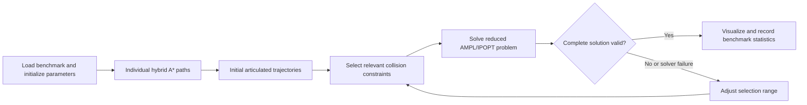

# Cooperative Maneuver Planning for Multiple Tractor–Trailer Vehicles

**Coordinate several articulated vehicles through one cluttered workspace.** This MATLAB/AMPL repository accompanies:

> Bai Li, Youmin Zhang, Ming Yue, Xiaoyan Peng, Xiang Zhong, and Qi Kong, “Cyber-physical System based Cooperative Maneuver Planning for Multiple Tractor-trailer Vehicles in a Cluttered Environment,” *2021 4th IEEE International Conference on Industrial Cyber-Physical Systems (ICPS)*, 297–302, 2021. [Paper / DOI](https://doi.org/10.1109/ICPS49255.2021.9468235).

## Planning method

The paper formulates a centralized minimum-time optimal-control problem for multiple tractor–trailer vehicles and solves it using **Adaptive-Scaling Constrained Optimization (ASCO)**. Initial individual paths provide a warm start. The algorithm retains a selected set of collision constraints, solves the resulting smaller nonlinear program, checks the complete solution, and adjusts the selection range when necessary.

The supplied model represents each vehicle as **one tractor and three trailers**, with four geometric centers. It accounts for vehicle–vehicle, vehicle–obstacle, and within-assembly collision constraints. The risk-range parameter selects constraints; it does not change the physical obstacle size.



## Dependencies

- **MATLAB on Windows**, with support for the included `.p` files.
- **AMPL** and an **AMPL-compatible IPOPT** executable. They are **not included** and must be installed separately.
- Any toolbox required by your MATLAB installation's hybrid-A*/Reeds–Shepp support. The search implementation is protected P-code; its internal toolbox calls are not exposed in this distribution.
- A writable working directory for AMPL parameter, initialization, status, and result files.

The original AMPL script uses Windows `del` commands. A native Linux/macOS port is not supplied. The nonlinear program exceeds small AMPL demonstration limits; use a license supporting the actual problem size. `ipopt.opt` selects **MA97**, so IPOPT must have access to that HSL solver; alternatively, select a supported solver such as `mumps` in this options file. HSL has separate installation and licensing requirements.

## Quick start: one benchmark first

1. Install AMPL/IPOPT and place their directory on the `PATH` visible to MATLAB.
2. Open MATLAB in this repository's root directory.
3. Near the top of `RunMe.m`, change the default batch loop to one case:

```matlab
for benchmark_case_id = 10
```

4. Run:

```matlab
setenv('PATH', ['C:\path\to\ampl', pathsep, getenv('PATH')]);
RunMe;
```

The original default is `10 : 40`, which runs **31 benchmarks**, not one. The `benchmarks/` directory contains 40 `.mat` inputs. A successful solve invokes the protected `asd.p` renderer. At the end of the selected batch, the script prints success rate, average optimization-loop CPU time, and average iteration count.

`cpu_time` starts after initial-path generation and the first constraint selection. It is therefore **not the complete end-to-end planning time**. Failed runs are recorded in `success_rate`; do not infer success from old text files left by a previous run.

## Parameters and files

The entry script sets a 1.5 m tractor wheelbase, speed limit 3 m/s, acceleration limit 0.5 m/s², steering limit 0.7 rad, and hybrid-A* search settings. `NLP.mod` uses 100 collocation points and minimizes the common terminal time. Scenario geometry, hitch parameters, and boundary configurations are loaded from the benchmark.

The adaptive selection loop starts at `s_ub = 0`, decreases it by 2 after a failed reduced solve, increases it by 0.5 after an invalid solution, and caps its upper value at 3. The code labels this loop `ACDO` in a comment; the publication's method name is **ASCO**.

| File | Purpose |
| --- | --- |
| `RunMe.m` | Select benchmarks, initialize parameters, run search and adaptive optimization, collect statistics. |
| `benchmarks/*.mat` | Stored configurations, obstacles, and scenario parameters. |
| `PlanHybridAStarPath.p` | Protected initial-path planner, invoked once for each tractor–trailer vehicle. |
| `WriteFilesForNLP.p` | Prepare scene-dependent model inputs. |
| `WriteInitialGuess.p` | Convert individual paths into the NLP warm start and return geometric centers. |
| `WriteObstaclesForReducedNLP.m` | Build/write `M_V2V`, `M_V2O`, and `M_V2S` masks selecting active collision constraints. |
| `NLP.mod` | Articulated kinematics, boundary conditions, mechanical limits, selected collision constraints, and minimum-time objective. |
| `r.run`, `ipopt.opt` | Call IPOPT, inspect its result, and export numerical values and a new warm start. |
| `LoadXY.m` | Reconstruct center coordinates from `xc.txt` and `yc.txt` as arrays of size `Nv × 4 × Nfe`. |
| `IsSolValid.p` | Protected complete-solution validation used after a successful reduced solve. |
| `asd.p` | Protected visualization of the accepted solution. |

AMPL exchanges data through local text files, including `ig.INIVAL`, the three mask files, `sol_status.txt`, trajectory coordinates/headings, and `terminal_moment.txt`. Keep these files together while a run is in progress. P-code helpers are executable components, not omitted source files to rename or regenerate.

The archive is the supplied numerical benchmark implementation. It does not include a live cyber-physical communication or vehicle-control deployment.

## Citation

```bibtex
@inproceedings{Li2021ICPS,
  author = {Bai Li and Youmin Zhang and Ming Yue and Xiaoyan Peng
            and Xiang Zhong and Qi Kong},
  title = {Cyber-physical System based Cooperative Maneuver Planning for
           Multiple Tractor-trailer Vehicles in a Cluttered Environment},
  booktitle = {2021 4th IEEE International Conference on Industrial
               Cyber-Physical Systems (ICPS)},
  pages = {297--302}, year = {2021},
  doi = {10.1109/ICPS49255.2021.9468235}
}
```

## License

See [LICENSE](LICENSE). AMPL, IPOPT, and other external dependencies retain their own licenses.
